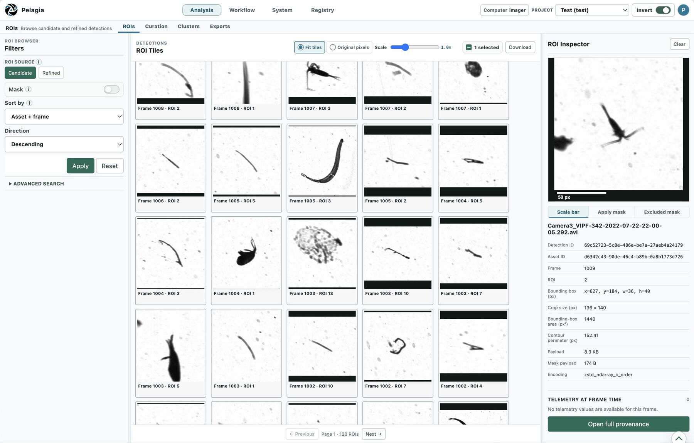
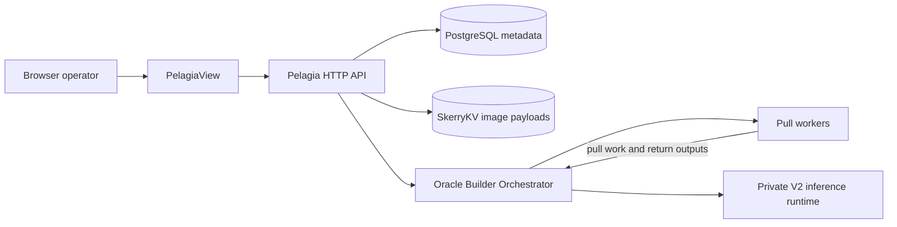

<p align="center">
  
</p>

# PelagiaView

PelagiaView is the browser workspace for [Pelagia](https://github.com/Icy-Seas-Co-Laboratory/Pelagia), a scientific image-ingestion and ROI-analysis backend. It gives operators one place to connect to a project, queue processing, inspect frames and masks, curate labels, review telemetry, and monitor workers.

PelagiaView talks to the Pelagia HTTP API. It does not read backend filesystems or communicate with workers directly.



*PelagiaView's ROI Browser: candidate gallery and selected ROI inspector. The display is inverted for this demonstration; the scale bar is in pixels and does not claim physical calibration. See the [capture provenance](docs/assets/README.md).*



## What you can do

- **Ingest and explore:** analyze videos, image folders, and Pelagia interchange datasets; preview frames and processing overlays.
- **Process:** submit preprocessing, segmentation, and ROI-refinement work with explicit asset, range, and state criteria.
- **Curate:** browse ROIs, review model evidence, assign project labels, and record human annotations.
- **Operate:** monitor jobs, workers, storage, telemetry imports, exports, and event logs.
- **Registry:** open the integrated `/registry/` workspace to inspect and edit project-scoped Oracle Dataset revisions.

## Start here

1. Start a Pelagia backend and at least one worker. See the [Pelagia getting started guide](https://github.com/Icy-Seas-Co-Laboratory/Pelagia/blob/main/docs/getting-started.md).
2. Follow [PelagiaView setup](docs/getting-started.md) to install and run this UI.
3. Open `http://127.0.0.1:5173/`, enter the backend URL, username, and password, then select an existing project.
4. If the account has no project, PelagiaView opens project setup. Provide a project key and storage location, create the project, and continue into the dashboard.

The first connection checks `/health` and `/system/status`. The endpoint is remembered in browser local storage; disconnecting clears the active UI session but does not stop backend work.

## Documentation

- [Documentation index](docs/index.md)
- [Getting started and deployment](docs/getting-started.md)
- [Operator workflows](docs/workflows.md)
- [Developer guide and API boundaries](docs/development.md)
- [Pelagia backend documentation](https://github.com/Icy-Seas-Co-Laboratory/Pelagia/tree/main/docs)
- [Oracle Builder documentation](https://github.com/Icy-Seas-Co-Laboratory/oracle-builder/tree/main/docs)

## Development

```bash
npm ci
npm run check
npm run build
```

Run the focused queue/session tests with `npm run test:queue-status`. Keep backend calls in `src/lib/api/client.ts`, preserve project/session scoping, and keep workflow state faithful to the server's queued, running, completed, and failed states.
